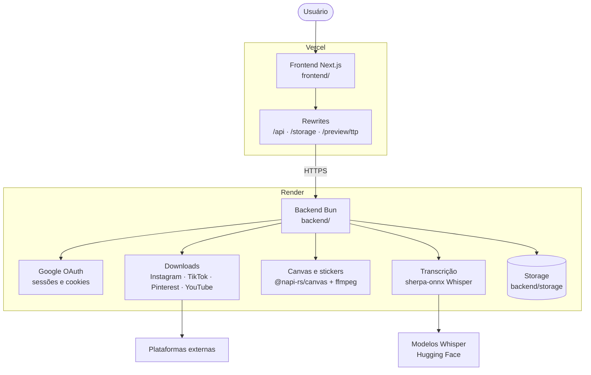

<p align="center">
  
</p>

<h1 align="center">Orbit API</h1>

<p align="center">
  Plataforma privada de downloads, geração de imagens, stickers e transcrição de áudio.
</p>

> [!IMPORTANT]
> **Projeto privado e confidencial da TheKingDevs.** O acesso é restrito a pessoas autorizadas. É proibida a clonagem, cópia, distribuição, publicação ou qualquer uso não autorizado deste projeto. Consulte o arquivo [LICENSE](LICENSE).

## Visão geral

A Orbit API é um monorepo com duas aplicações independentes:

- **Frontend** em Next.js, hospedado na Vercel.
- **Backend** em Bun, hospedado no Render.

O frontend encaminha `/api`, `/storage`, `/preview/ttp` e os assets necessários para o backend por meio de rewrites do Next.js. Como os hosts são separados, o deploy e a disponibilidade de cada aplicação são independentes.

## Funcionalidades

- Downloads de Instagram, TikTok (vídeo e áudio), Pinterest e YouTube (vídeo e áudio).
- Geração de cards e imagens com Canvas (`welcome`, `goodbye`, `ttp`, `attp` e efeitos).
- Criação de stickers (`ttp`, `attp`, `brat`, `abrat`) e conversão para GIF.
- Transcrição de áudio e vídeo com Whisper via `sherpa-onnx`.
- Autenticação com Google OAuth, sessões e cookies.
- API keys com níveis público, admin e owner.
- Controle de uso, saldo e planos de usuário.
- Painel com documentação, novidades, chaves e métricas de uso.

## Arquitetura



Diagramas adicionais:

- [Arquitetura](assets/diagrams/architecture.mermaid)
- [Deploy e hospedagem](assets/diagrams/deployment.mermaid)
- [Fluxo de contribuição](assets/diagrams/workflow.mermaid)

## Stack

| Camada | Tecnologias |
| --- | --- |
| Frontend | Next.js 16, React 19, Tailwind CSS 4, TypeScript |
| Backend | Bun, TypeScript, `@napi-rs/canvas`, `ffmpeg`, `sherpa-onnx`, `jose`, `zod` |
| Infraestrutura | GitHub, Render, Vercel |
| Integrações | Google OAuth, Hugging Face |

## Estrutura do repositório

```text
orbit-api/
├── backend/
│   ├── src/
│   │   ├── routes/
│   │   ├── services/
│   │   ├── middlewares/
│   │   └── utils/
│   ├── assets/fonts/
│   ├── storage/
│   └── render.yaml
├── frontend/
│   ├── src/app/
│   ├── src/components/
│   ├── src/lib/
│   └── public/
├── assets/
│   ├── images/
│   └── diagrams/
├── scripts/
├── Makefile
├── CONTRIBUTING.md
└── LICENSE
```

## Pré-requisitos

- [Bun](https://bun.sh/) instalado (backend).
- Node.js 20 ou superior e npm (frontend).
- `ffmpeg` disponível no `PATH` (processamento de imagens).
- Git.
- Docker é opcional; o backend possui `backend/Dockerfile`.

## Configuração

Crie os arquivos de ambiente a partir dos exemplos:

```bash
cp backend/.env.example backend/.env
cp frontend/.env.example frontend/.env
```

Preencha os valores locais. **Nunca versione arquivos `.env`.**

### Backend (`backend/.env`)

| Variável | Descrição |
| --- | --- |
| `PORT` | Porta do servidor (padrão: `3000`). |
| `BACKEND_URL` | URL pública/interna do backend. |
| `FRONTEND_URL` | URL do frontend usada nos redirecionamentos OAuth. |
| `GOOGLE_CLIENT_ID` / `GOOGLE_CLIENT_SECRET` | Credenciais do Google OAuth. |
| `GOOGLE_REDIRECT_URI` | Callback OAuth encaminhado pelo proxy do frontend. |
| `SESSION_TTL_HOURS` / `SESSION_IDLE_MINUTES` / `SESSION_ROTATE_HOURS` | Política de sessão. |
| `COOKIE_SECURE` | Use `true` em produção com HTTPS. |
| `OWNER_API_KEY` / `ADMIN_API_KEY` / `PUBLIC_API_KEY` | Chaves de acesso da API. |
| `CORS_ORIGIN` | Origem permitida para requisições do frontend. |
| `PUBLIC_BASE_URL` | URL pública usada na geração de links (produção). |
| `DOCS_PREVIEW_DAILY_LIMIT` | Limite diário de pré-visualizações da documentação. |
| `MONGO_URI` | Connection string do MongoDB. Obrigatória em produção. |
| `MONGO_DB_NAME` | Nome do banco de dados MongoDB (padrão: `orbit`). |

### Frontend (`frontend/.env`)

| Variável | Descrição |
| --- | --- |
| `BACKEND_URL` | URL do backend usada pelos rewrites do Next.js. |
| `NEXT_PUBLIC_APP_NAME` | Nome exibido na interface. |
| `NEXT_PUBLIC_API_URL` | URL pública da API nos exemplos de código. |
| `NEXT_PUBLIC_WHATSAPP_CHANNEL_URL` | URL do canal de atualizações. |

## Instalação

```bash
# backend
cd backend
bun install

# frontend
cd ../frontend
npm install
```

## Desenvolvimento

Na raiz do projeto:

```bash
make run-dev
```

Ou em terminais separados:

```bash
# backend — http://localhost:3000
cd backend
bun run dev

# frontend — http://localhost:3001
cd frontend
npm run dev
```

Acesse `http://localhost:3001`.

## Produção local

```bash
make run
```

O comando compila o backend e o frontend e inicia os dois em modo de produção.

## Scripts úteis

| Comando | Descrição |
| --- | --- |
| `make run-dev` | Inicia backend e frontend em desenvolvimento. |
| `make run` | Compila e inicia backend e frontend em produção. |
| `make clean` | Remove `dist`, `.next` e `node_modules`. |
| `make clean-cache` | Limpa caches de build. |
| `./scripts/build-backend.sh` | Instala dependências e compila somente o backend. |
| `./scripts/deploy.sh` | Executa o build de backend e frontend para deploy. |
| `cd backend && bun test` | Executa os testes do backend. |
| `cd frontend && npm run lint` | Executa o lint do frontend. |

## Testes e qualidade

```bash
# testes do backend
cd backend
bun test

# lint do frontend
cd frontend
npm run lint

# build de verificação
cd frontend
npm run build
```

## Deploy

### Backend — Render

- Runtime: Docker.
- Blueprint: `backend/render.yaml`.
- Dockerfile: `backend/Dockerfile` (contexto `backend`).
- A imagem já instala `ffmpeg`, `yt-dlp`, fontes e os modelos Whisper usados pela transcrição.
- Configure as variáveis de ambiente no painel do Render, principalmente `PUBLIC_BASE_URL`, `CORS_ORIGIN`, `MONGO_URI` e as credenciais OAuth.
- Usuários, sessões e histórico de uso ficam persistidos no MongoDB configurado por `MONGO_URI`.
- O build filter usa `backend/**`, evitando redeploys causados por mudanças no frontend.
- Se configurar manualmente pelo painel, use Dockerfile Path `backend/Dockerfile` e Docker Context `backend`.

### Frontend — Vercel

- Root Directory: `frontend`.
- Build Command: `npm run build`.
- Configure `BACKEND_URL` apontando para o backend no Render.
- Configure as variáveis `NEXT_PUBLIC_*` no painel da Vercel.
- Opcionalmente, use o Ignored Build Step para ignorar commits que não alteram o frontend:

```bash
git diff HEAD^ HEAD --quiet -- .
```

Os rewrites de `/api`, `/storage`, `/preview/ttp` e `/assets/html-to-image.js` estão definidos em `frontend/next.config.ts`.

## Segurança e confidencialidade

- Repositório privado, de propriedade exclusiva da **TheKingDevs**.
- Acesso permitido apenas a membros autorizados.
- Não commite `.env`, tokens, chaves ou credenciais.
- Use as variáveis de ambiente de cada host para segredos.
- Em caso de exposição acidental, revogue e rotacione as chaves imediatamente.
- É proibida a clonagem, cópia, distribuição ou uso não autorizado do projeto.
- Recomenda-se proteger `main` com Pull Request obrigatório, aprovação de code owner e checks de CI.

## Contribuição

O fluxo de trabalho, padrões de commit e regras de revisão estão em [CONTRIBUTING.md](CONTRIBUTING.md).

## Licença

Este projeto é proprietário e confidencial. Todos os direitos pertencem à **TheKingDevs**. Consulte [LICENSE](LICENSE) para os termos completos.
