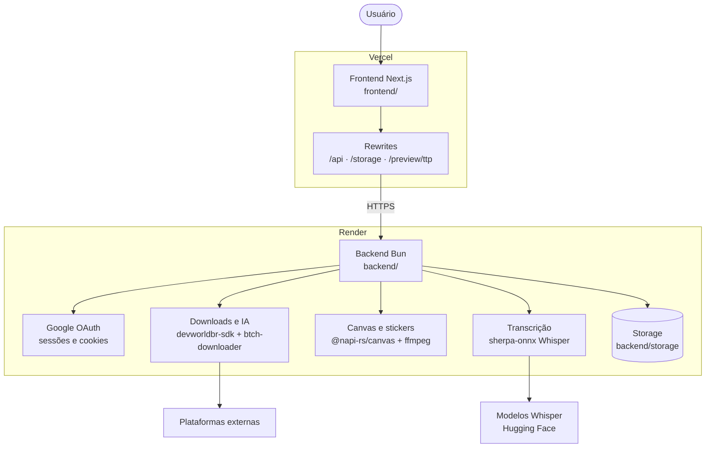

<p align="center">
  
</p>

<h1 align="center">Orbit API</h1>

<p align="center">
  Plataforma privada de downloads, geração de imagens, stickers e transcrição de áudio.
</p>

> [!IMPORTANT]
> **Projeto privado e confidencial da TheKingDevs.** O acesso é restrito a pessoas autorizadas. É proibida a clonagem, cópia, distribuição, publicação ou qualquer uso não autorizado deste projeto. Consulte o arquivo [LICENSE](LICENSE).

## Visão geral

A Orbit API é um monorepo com duas aplicações independentes:

- **Frontend** em Next.js, hospedado na Vercel.
- **Backend** em Bun, hospedado no Render.

O frontend encaminha `/api`, `/storage`, `/preview/ttp` e os assets necessários para o backend por meio de rewrites do Next.js. Como os hosts são separados, o deploy e a disponibilidade de cada aplicação são independentes.

## Funcionalidades

- Downloads de Instagram, TikTok (vídeo, áudio e imagens/slides), Pinterest (URL ou pesquisa), YouTube, Facebook, SoundCloud, Spotify, Threads, Google Drive, CapCut e Twitter/X.
- Inteligência artificial com GPT, Groq, Gemini, OCR local de imagens, resumo de texto e resumo de áudio com transcrição Whisper.
- Pesquisas de YouTube (`v1` e `v2`) e wallpapers.
- Geração de cards e imagens com Canvas (`welcome`, `goodbye`, `ttp`, `attp` e efeitos).
- Criação de stickers (`ttp`, `attp`, `brat`, `abrat`) e conversão para GIF.
- Transcrição de áudio e vídeo com Whisper via `sherpa-onnx`.
- Autenticação com Google OAuth, sessões e cookies.
- API keys com níveis público, admin e owner.
- Controle de uso, saldo e planos de usuário.
- Painel com documentação, novidades, chaves e métricas de uso.

## Arquitetura



Diagramas adicionais:

- [Arquitetura](assets/diagrams/architecture.mermaid)
- [Deploy e hospedagem](assets/diagrams/deployment.mermaid)
- [Fluxo de contribuição](assets/diagrams/workflow.mermaid)

## Stack

| Camada | Tecnologias |
| --- | --- |
| Frontend | Next.js 16, React 19, Tailwind CSS 4, TypeScript |
| Backend | Bun, TypeScript, `@napi-rs/canvas`, `ffmpeg`, `yt-dlp`, Deno, `sherpa-onnx`, `jose`, `zod` |
| Infraestrutura | GitHub, Render, Vercel |
| Integrações | Google OAuth, Hugging Face, `btch-downloader` |

## Estrutura do repositório

- 📁 `backend` ➔ _API REST Bun; estrutura detalhada em [`backend/README.md`](backend/README.md)_
  - 📁 `src/routes` ➔ _endpoints públicos, API, administração e owner_
  - 📁 `src/services` ➔ _downloads, IA, sessões, MongoDB, storage, canvas e transcrição_
  - 📁 `assets/fonts` ➔ _fontes para geração de mídia_
  - 📁 `models/whisper-tiny` ➔ _arquivos do modelo local de transcrição_
  - 📁 `storage` ➔ _mídias temporárias de execução_
  - 📝 `Dockerfile` e `render.yaml` ➔ _imagem e configuração de deploy do backend_
- 📁 `frontend` ➔ _aplicação Next.js; estrutura detalhada em [`frontend/README.md`](frontend/README.md)_
  - 📁 `src/app` ➔ _landing page, dashboard, docs, planos e administração_
  - 📁 `src/components` ➔ _interface, playgrounds e componentes de página_
  - 📁 `src/lib` ➔ _autenticação, HTTP, catálogo de endpoints, SEO e novidades_
  - 📁 `public` ➔ _logos e assets públicos_
- 📁 `assets` ➔ _identidade visual e documentação visual_
  - 📁 `images` ➔ _logos e imagens_
  - 📁 `diagrams` ➔ _arquitetura, deploy e fluxo de contribuição_
- 📁 `scripts` ➔ _scripts de build e deploy_
- 📝 `Makefile` ➔ _atalhos de desenvolvimento e produção_
- 📝 `CONTRIBUTING.md` ➔ _guia de contribuição_
- 📝 `LICENSE` ➔ _termos da licença_
- 📝 `README.md` ➔ _visão geral do monorepo_

## Pré-requisitos

- [Bun](https://bun.sh/) instalado (backend).
- Node.js 20.9 ou superior e npm (frontend).
- `ffmpeg` disponível no `PATH` para processamento local de mídia.
- Node.js 22+ ou Deno para extração de mídia do YouTube via yt-dlp (Docker instala Deno).
- Git.
- Docker é opcional; o backend possui `backend/Dockerfile`.

## Configuração

Crie os arquivos de ambiente a partir dos exemplos:

```bash
cp backend/.env.example backend/.env
cp frontend/.env.example frontend/.env
```

Preencha os valores locais. **Nunca versione arquivos `.env`.**

### Backend (`backend/.env`)

| Variável | Descrição |
| --- | --- |
| `PORT` | Porta do servidor (padrão: `3000`). |
| `BACKEND_URL` | URL pública/interna do backend. |
| `FRONTEND_URL` | URL do frontend usada nos redirecionamentos OAuth. |
| `GOOGLE_CLIENT_ID` / `GOOGLE_CLIENT_SECRET` | Credenciais do Google OAuth. |
| `GOOGLE_REDIRECT_URI` | Callback OAuth encaminhado pelo proxy do frontend. |
| `SESSION_TTL_HOURS` / `SESSION_IDLE_MINUTES` / `SESSION_ROTATE_HOURS` | Política de sessão. |
| `COOKIE_SECURE` | Use `true` em produção com HTTPS. |
| `OWNER_API_KEY` / `ADMIN_API_KEY` / `PUBLIC_API_KEY` | Chaves de acesso da API. |
| `OWNER_EMAIL` | E-mail reservado ao papel owner; configure no ambiente, sem codificá-lo no projeto. |
| `CORS_ORIGIN` | Allowlist de origens web cross-origin. Aceita origens HTTP(S) separadas por vírgula, sem caminhos ou curingas; controla CORS, preflight e validação de origem da sessão. |
| `PUBLIC_BASE_URL` | URL pública usada na geração de links (produção). |
| `DOCS_PREVIEW_DAILY_LIMIT` | Limite diário de pré-visualizações da documentação. |
| `MONGO_URI` | Connection string do MongoDB. Obrigatória em produção. |
| `MONGO_DB_NAME` | Nome do banco de dados MongoDB (padrão: `orbit`). |
| `DATA_ENCRYPTION_KEY` | Chave Base64 de 32 bytes para criptografia e hashes; gere com `openssl rand -base64 32` e não altere sem migração. |
| `AIHORDE_API_KEY` | Chave opcional para geração de imagens via AI Horde. |
| `YTDLP_JS_RUNTIME` | Runtime opcional para yt-dlp; vazio detecta Node 22+ e depois Deno. |
| `TIKTOK_COOKIES_FILE` | Caminho opcional para cookies Netscape privados quando o TikTok exigir sessão. |

### Frontend (`frontend/.env`)

| Variável | Descrição |
| --- | --- |
| `BACKEND_URL` | URL do backend usada pelos rewrites do Next.js. |
| `NEXT_PUBLIC_APP_NAME` | Nome exibido na interface. |
| `NEXT_PUBLIC_SITE_URL` | URL pública do site usada em SEO, Open Graph, sitemap e robots. |
| `NEXT_PUBLIC_API_URL` | URL pública da API nos exemplos de código. |
| `NEXT_PUBLIC_WHATSAPP_CHANNEL_URL` | URL do canal de atualizações. |

## Instalação

```bash
# backend
cd backend
bun install --frozen-lockfile

# frontend
cd ../frontend
npm ci
```

## Desenvolvimento

Na raiz do projeto:

```bash
make run-dev
```

Ou em terminais separados:

```bash
# backend — http://localhost:3000
cd backend
bun run dev

# frontend — http://localhost:3001
cd frontend
npm run dev
```

Acesse `http://localhost:3001`.

## Produção local

```bash
make run
```

O comando compila o backend e o frontend e inicia os dois em modo de produção.

## Scripts úteis

| Comando | Descrição |
| --- | --- |
| `make run-dev` | Inicia backend e frontend em desenvolvimento. |
| `make run` | Compila e inicia backend e frontend em produção. |
| `make clean` | Remove `dist`, `.next` e `node_modules`. |
| `make clean-cache` | Limpa caches de build. |
| `./scripts/build-backend.sh` | Instala dependências e compila somente o backend. |
| `./scripts/deploy.sh` | Abre a CLI interativa para build e publicação no Render e na Vercel. |
| `cd backend && bun test` | Executa os testes do backend. |
| `cd frontend && npm run lint` | Executa o lint do frontend. |

## Testes e qualidade

```bash
# testes do backend
cd backend
bun test

# lint do frontend
cd frontend
npm run lint

# build de verificação
cd frontend
npm run build
```

## Deploy

### CLI interativa

A ferramenta em `scripts/deploy.ts` oferece menus, confirmações e mensagens de progresso para publicar frontend, backend ou ambos. Ela executa os CLIs oficiais e deixa os binários locais ignorados pelo Git:

```bash
cd scripts && npm ci
./deploy.sh
```

O banner FIGlet é centralizado no terminal, e a CLI apresenta as etapas do fluxo com barra de progresso e atividade atual. O pacote `vercel` fica instalado localmente em `scripts/node_modules/.bin`. Para instalar o binário oficial do Render dentro de `scripts/.tools/bin` (Linux/macOS x64 e ARM64; requer `curl` e `unzip`), use `cd scripts && npm run install-render`. A ferramenta também reconhece um `render` já disponível no `PATH`.

Para localizar o serviço Render, a CLI lista os serviços do workspace autenticado e compara seus nomes com o `name` em `backend/render.yaml` (por padrão, `orbit-backend`). Se o nome não corresponder, mas houver apenas um serviço web acessível, usa esse serviço; com vários, permite escolher. `RENDER_SERVICE_ID` define um ID explícito e `RENDER_SERVICE_NAME` troca o nome usado na busca. IDs manuais são comparados com a lista acessível pela API key antes dos builds. Se o Render não responder por erro de rede/DNS, a CLI interrompe antes dos builds. Se a resposta de deploy indicar que o repositório GitHub conectado não foi encontrado, a CLI informa o ID do repositório e orienta a reconectar a integração no painel Render; esse caso não usa fallback para evitar mascarar o diagnóstico. Outros erros 404 de deploy ainda tentam o Render CLI como alternativa.

O frontend usa o projeto já vinculado em `frontend/.vercel/project.json`; se não houver vínculo local, o CLI da Vercel permite selecionar um projeto pela conta autenticada. Para aguardar a conclusão do deploy do Render, informe ou configure `RENDER_SERVICE_ID`; sem ID, a CLI do Render permite escolher o serviço e retorna assim que aceita o deploy. Os dois provedores precisam estar autenticados. Confirme cada publicação de produção quando solicitado.

O código e os metadados oficiais dos comandos estão em [Render CLI](https://render.com/docs/cli) e [Vercel CLI](https://vercel.com/docs/projects/deploy-from-cli).

### Backend — Render

- Runtime: Docker.
- Blueprint: `backend/render.yaml`.
- Dockerfile: `backend/Dockerfile` (contexto `backend`).
- A imagem instala `ffmpeg`, `yt-dlp`, Deno, fontes e os modelos Whisper usados pela transcrição.
- Configure as variáveis de ambiente no painel do Render, principalmente `PUBLIC_BASE_URL`, `CORS_ORIGIN`, `FRONTEND_URL`, `BACKEND_URL`, `MONGO_URI`, `DATA_ENCRYPTION_KEY` e as credenciais OAuth.
- Usuários, sessões e histórico de uso ficam persistidos no MongoDB configurado por `MONGO_URI`.
- O build filter usa `backend/**`, evitando redeploys causados por mudanças no frontend.
- Se configurar manualmente pelo painel, use Dockerfile Path `backend/Dockerfile` e Docker Context `backend`.

### Frontend — Vercel

- Root Directory: `frontend`.
- Build Command: `npm run build`.
- Configure `BACKEND_URL` apontando para o backend no Render.
- Configure as variáveis `NEXT_PUBLIC_*` no painel da Vercel.
- Opcionalmente, use o Ignored Build Step para ignorar commits que não alteram o frontend:

```bash
git diff HEAD^ HEAD --quiet -- .
```

Os rewrites de `/api`, `/storage`, `/preview/ttp` e `/assets/html-to-image.js` estão definidos em `frontend/next.config.ts`.

## Segurança e confidencialidade

- Repositório privado, de propriedade exclusiva da **TheKingDevs**.
- Acesso permitido apenas a membros autorizados.
- Não commite `.env`, tokens, chaves ou credenciais.
- Use as variáveis de ambiente de cada host para segredos.
- Em caso de exposição acidental, revogue e rotacione as chaves imediatamente.
- É proibida a clonagem, cópia, distribuição ou uso não autorizado do projeto.
- Recomenda-se proteger `main` com Pull Request obrigatório, aprovação de code owner e checks de CI.

## Contribuição

O fluxo de trabalho, padrões de commit e regras de revisão estão em [CONTRIBUTING.md](CONTRIBUTING.md).

## Licença

Este projeto é proprietário e confidencial. Todos os direitos pertencem à **TheKingDevs**. Consulte [LICENSE](LICENSE) para os termos completos.
